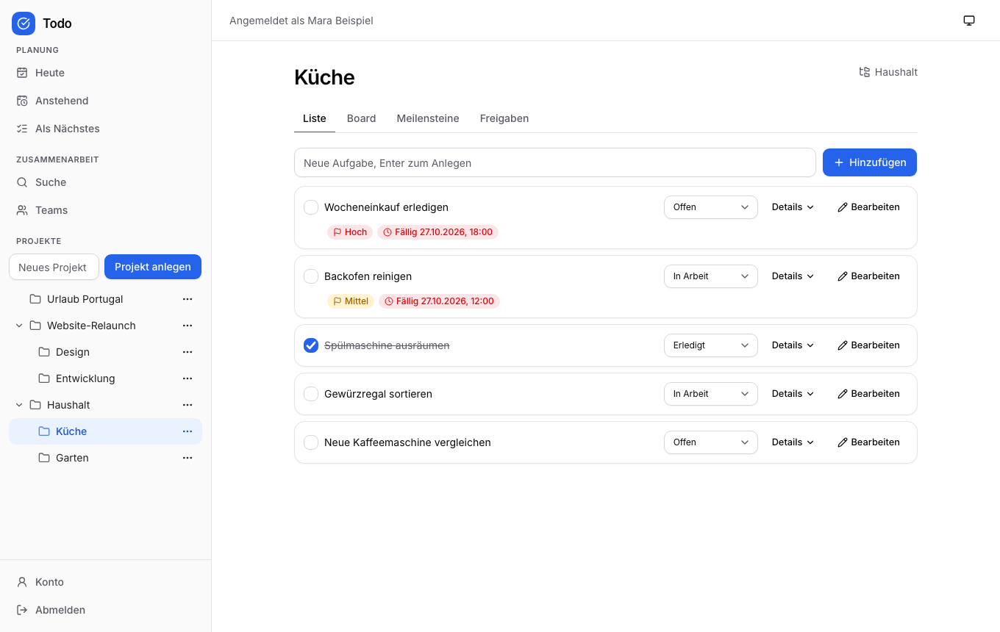
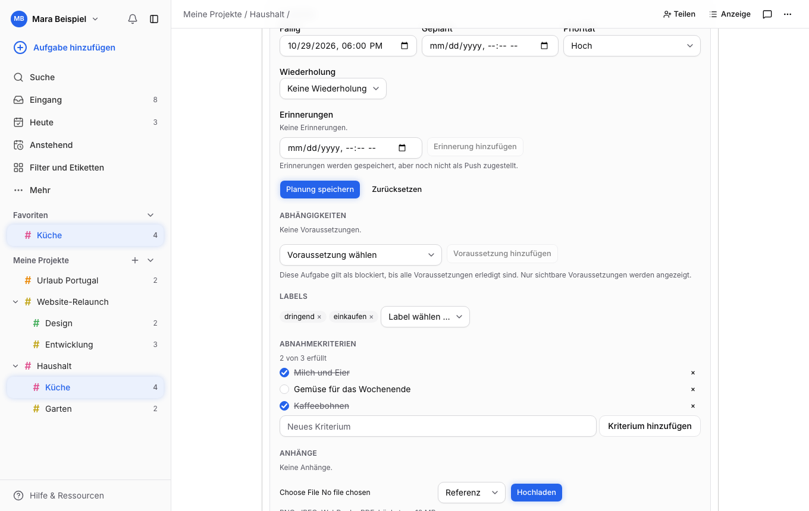
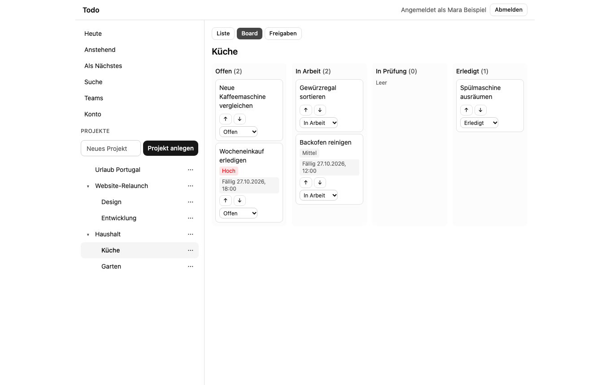
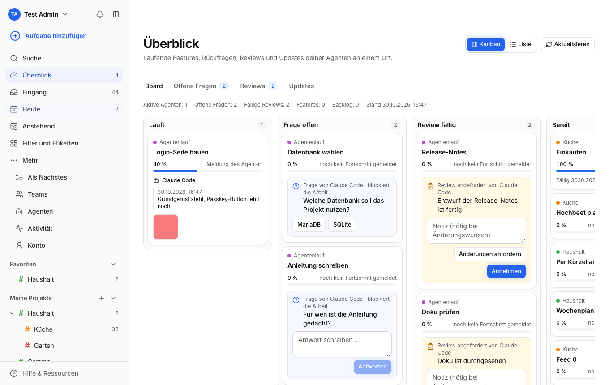
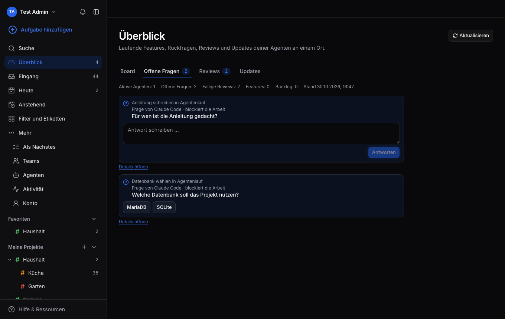
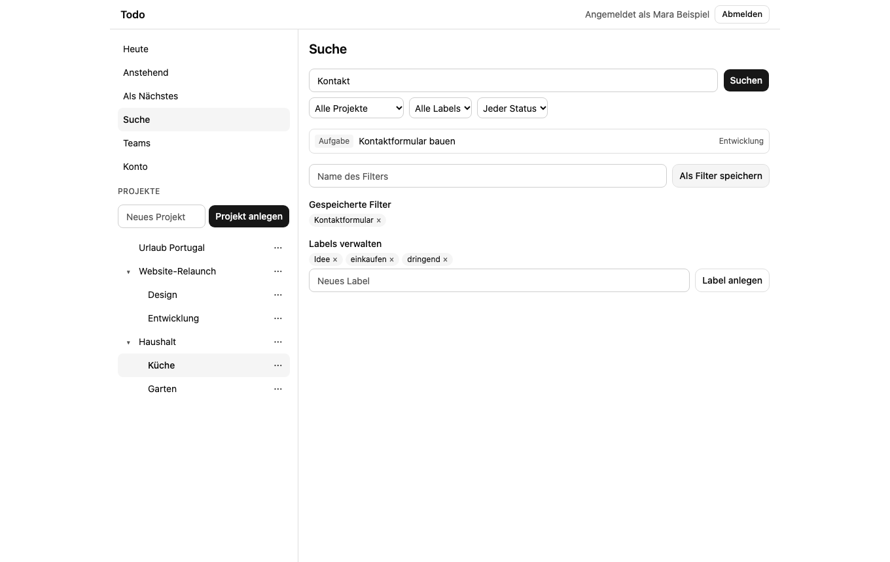
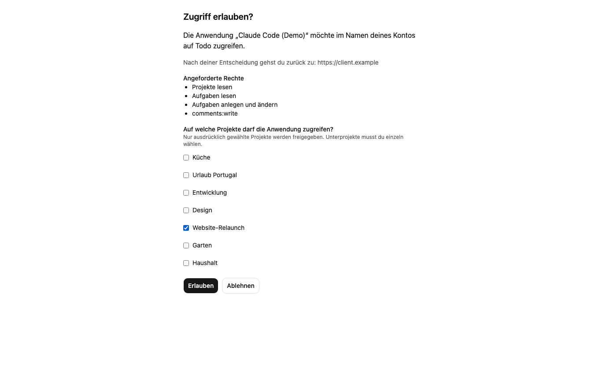
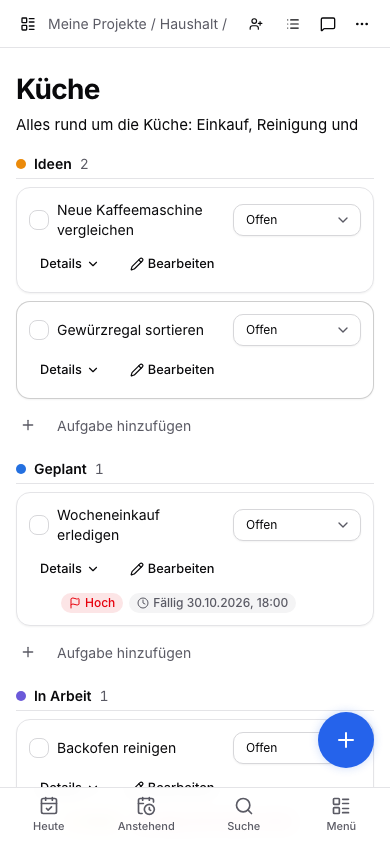

# Todolino

Intuitive Todo- und Projektplanung für Menschen und ihre Coding-Agenten: unbegrenzt verschachtelte Projekte mit projektspezifischen Kanban-Spalten, Teams und Freigaben, Passkey zuerst, als PWA und SwiftUI-App, mit MCP/OAuth-Anbindung, lokalen Mac-Runnern für Claude Code und einer Steuerzentrale, in der Rückfragen, Fortschritt, Reviews und Screenshots der Agenten zusammenlaufen.

Produktname: **Todolino** (technische Namen wie Repository, Module, Image und Domain bleiben „todo“). Status: in aktiver Entwicklung, noch nicht für den Produktivbetrieb freigegeben (siehe [Status und Grenzen](#status-und-grenzen)).

## Produktüberblick

- **Projekte und Aufgaben:** beliebig tiefe Projekthierarchie, jedes Projekt mit eigenen Kanban-Spalten und Darstellung (Liste oder Board), Unteraufgaben, Labels, Fälligkeit und geplante Bearbeitung getrennt, Priorität, Abhängigkeiten, Meilensteine, Wiederholungen, Suche mit gespeicherten Filtern.
- **Zusammenarbeit:** Teams, Projektfreigaben mit vererbten Rechten (lesen, kommentieren, bearbeiten, verwalten), Aufgaben- und Projektkommentare, Aktivitätsfeed, Abnahmekriterien, Anhänge.
- **Identität:** Passkeys (WebAuthn), mehrere benannte Passkeys, Sessions, Wiederherstellung per Einmalcode, Rate-Limits. Passwort-Login nur optional.
- **Clients:** PWA (SvelteKit, vom Backend mit ausgeliefert) und SwiftUI-Apps für iOS, iPadOS, macOS und watchOS im [Apple-Repository](https://github.com/MagicalWig34653/todo-apple); beide nutzen dieselbe API und denselben Sync-Feed.
- **Agenten:** MCP-Endpunkt `/mcp` mit OAuth (PKCE, Resource Indicators), Agentenhandbuch und Projekt-Briefing; Agenten arbeiten über das Kanban-Board (übernehmen, Fortschritt melden, Fragen stellen, Screenshots anhängen, Review anfordern). Aufträge und Checkpoints liegen in der App, nicht in einer Chat-Sitzung.
- **Steuerzentrale („Überblick“):** laufende Features mit Fortschritt, offene Fragen, fällige Reviews, Updates und Build-Screenshots als Kanban oder Liste; Fragen beantworten und Reviews entscheiden direkt dort ([ADR 0014](docs/adr/0014-steuerzentrale-agenten-kanban.md)).
- **Lokale Mac-Runner:** starten Claude Code im freigegebenen Projektordner und melden Fortschritt, Rückfragen und Ergebnis an die Aufgabe (Einrichtung: [RUNNER.md im Apple-Repository](https://github.com/MagicalWig34653/todo-apple/blob/main/docs/RUNNER.md)).
- **Projekt-Onboarding:** Claude-Code-Plugin und Prompts, die ein Repository ins Board importieren und die Aktualität überwachen ([ADR 0018](docs/adr/0018-projekt-onboarding-und-aktualitaet.md)).

## Screenshots

Echte Aufnahmen der PWA (Demo-Daten, Chromium mit virtuellem Passkey). Weitere unter [docs-site/screenshots/](docs-site/screenshots/).



*Projektbaum mit frei verschachtelten Projekten und Aufgabenliste (Desktop)*



*Aufgabendetail mit Planung, Labels, Abnahmekriterien und Kommentaren*



*Projektspezifisches Kanban-Board mit eigenen Spalten*



*Steuerzentrale: laufende Agentenarbeit, offene Fragen und fällige Reviews*



*Offene Fragen der Agenten direkt beantworten (dunkles Design)*



*Suche mit gespeicherten Filtern*



*OAuth-Zustimmung für einen KI-Assistenten (MCP)*



*Aufgabenliste auf dem Smartphone*

## Architektur

```text
PWA / SwiftUI / MCP-Clients / Mac-Runner
                  | HTTPS
          API-Replikate (Swift, Vapor)
     gemeinsame Fachlogik und Rechteprüfung
                  |
        MariaDB (Dateien standardmäßig darin; S3 optional)
```

- Backend: Swift 6.2, Vapor, Fluent; modularer Monolith (`Sources/TodoKit`). REST, MCP und Apps nutzen dieselben Fachregeln und dieselbe Rechteprüfung (`ProjectAccess`).
- Datenbank: MariaDB 12.3 im Betrieb, SQLite für schnelle Tests.
- PWA: SvelteKit 3, Tailwind, shadcn-svelte, statische Auslieferung (`web/`).
- Dateien: standardmäßig in der Datenbank (`ATTACHMENT_STORAGE=database`, ADR 0013); S3-kompatibler Speicher ist optional (Tests: Adobe S3Mock über Compose-Profil `s3`).
- Die PWA wird vom Backend-Image selbst ausgeliefert (ADR 0015); `/v1`, `/mcp`, `/oauth` und `/.well-known` bleiben Backend-Routen.
- Apple-Apps und Mac-Runner liegen in einem separaten Repository; API-Verträge liegen hier unter `contracts/`.

Details: [docs/ARCHITEKTUR.md](docs/ARCHITEKTUR.md).

## Schnellstart (Entwicklung)

Voraussetzungen: Swift 6.2+, Docker, Node 22+. Hinweis: Der Dev-Stack braucht freien Platz in der Docker-VM; ohne Docker laufen `swift test` (SQLite) und die PWA-Prüfungen trotzdem.

Ports der Entwicklungsumgebung:

| Dienst | Port |
| --- | --- |
| MariaDB | 23306 |
| S3Mock (optional, Profil `s3`) | 29090 |
| Backend (Docker) | 28080 |
| PWA (Vite-Dev-Server) | 25173 |

```sh
cp .env.example .env                      # nur Dev-Platzhalter, keine echten Zugangsdaten
docker compose up -d --wait db            # MariaDB (23306); S3 ist nicht nötig (optional: --profile s3)
docker compose --profile app up -d --wait backend   # Backend im Container (28080)
# alternativ lokal: swift run App serve --port 28081

cd web && npm install
npm run dev -- --port 25173               # PWA; proxyt API-Aufrufe an das Backend
```

Die Datenbank muss vor dem Betrieb migriert werden (Compose-Profil `app` enthält einen Migrationsdienst). Das Bootstrap-Token für das erste Admin-Konto stammt aus der Umgebung (`.env.example`).

Produktiver Swarm: `deploy/swarm/setup.sh` führt interaktiv (oder mit `--non-interactive --answers-file`) durch Einstellungen, Secrets, Deploy und Prüfung; siehe [Erstinstallation mit setup.sh](docs/BETRIEB.md#erstinstallation-mit-setupsh).

## Betrieb (Server ohne Quellcode)

Produktiv läuft das Backend als Docker-Swarm-Stack mit externer MariaDB. Für den Server genügt der quellfreie Branch `deploy`; das Backend-Image kommt fertig von GHCR.

```sh
git clone --branch deploy --depth 1 https://github.com/MagicalWig34653/todo.git
cd todo
deploy/swarm/setup.sh --dry-run          # dann ohne --dry-run; interaktiv oder --non-interactive --answers-file
# später: git pull --ff-only && deploy/swarm/update.sh
```

- **`deploy`-Branch:** wird von `.github/workflows/deploy-branch.yml` bei jedem relevanten Push auf `main` automatisch fortgeschrieben (nie von Hand ändern). Inhalt: Setup-/Update-/Backup-/Restore-Skripte, Stack-Dateien, `BETRIEB.md`.
- **`setup.sh` / `update.sh`:** Einstellungen, Secrets, Migration, Rolling Update und Prüfung; `update.sh` nimmt das neueste `sha-<commit>`-Image. Vor einem Update die Datenbank sichern (`scripts/backup-db.sh`).
- **Image:** `ghcr.io/magicalwig34653/todo-backend`, Multi-Arch (`linux/amd64`, `linux/arm64`), enthält die PWA. Tags `edge`, `sha-<commit>`, `<version>`.
- **OAuth-Issuer:** `OAUTH_ISSUER` (sonst abgeleitet aus `RP_ORIGIN`, in Produktion nie localhost) bestimmt die öffentliche Basis-URL der OAuth-/MCP-Discovery (ADR 0016). Nach einem Wechsel müssen sich Clients neu verbinden.
- **Cleanup und Sync-Aufbewahrung:** `CLEANUP_INTERVAL_MINUTES` (Standard 360, `0` = aus) steuert den periodischen Cleanup-Task der Replikate, `SYNC_RETENTION_DAYS` (Standard 90, `0` = alles behalten) die Aufbewahrung des Sync-Protokolls; Clients mit älterem Cursor erhalten 410 `cursor_expired` und laden neu (ADR 0019).

Details, Grenzen und Nachweise: [docs/BETRIEB.md](docs/BETRIEB.md).

## Claude Code einrichten

Todolino einmal global hinzufügen, danach im Projekt sagen „Richte das Projekt in Todolino ein“:

```text
/plugin marketplace add MagicalWig34653/todo
/plugin install todolino@todolino
```

Das Plugin (`claude-plugin/`) enthält den MCP-Server, drei Skills und Hooks (Erinnerung an Fortschritt und `record_sync`). Anmelden mit `/mcp` → `todolino`. Ohne Plugin: `claude mcp add --transport http --scope user todolino https://<host>/mcp` und den Textbaustein aus der Anleitung in die globale CLAUDE.md. Schritte, Grenzen der Durchsetzung und offene Annahmen (z. B. Account-Wechsel): [docs/CLAUDE-CODE-EINRICHTUNG.md](docs/CLAUDE-CODE-EINRICHTUNG.md). Handbuch für Agenten: [docs/agent-manual.md](docs/agent-manual.md).

## Tests

```sh
swift test                                # Backend, SQLite (MariaDB-Tests werden übersprungen)
scripts/test-mariadb.sh                   # Backend gegen echte MariaDB (docker compose up -d db)
cd web
npm run check                             # svelte-check
npm run build                             # statischer Build
npm test                                  # Vitest
npm run test:e2e                          # Playwright, braucht laufendes Backend-Image (kein S3Mock nötig)
```

Liegt der Checkout in einem File-Provider-Ordner (z. B. `~/Documents`), scheitert `swift test` am Codesigning; Workaround: `--scratch-path` auf einen Ordner außerhalb. Siehe [docs/STATUS.md](docs/STATUS.md).

## CI und Veröffentlichung

- `.github/workflows/ci.yml`: Swift-Build und -Tests (SQLite), PWA-Check, -Build und Vitest. Playwright-E2E und MariaDB-Suite laufen nicht in der CI, sondern lokal gegen einen isolierten Stack.
- `.github/workflows/docker-publish.yml`: baut das Backend-Image (mit PWA) für amd64 und arm64 und veröffentlicht es nach `ghcr.io/<owner>/<repo>-backend` (Branch `main`, Tags `v*`).
- `.github/workflows/deploy-branch.yml`: schreibt den quellfreien Branch `deploy` fort.
- `.github/workflows/pages.yml`: veröffentlicht die statische Projektseite aus `docs-site/` auf GitHub Pages.

## Repository-Struktur

```text
Sources/App          Einstiegspunkt des Backends
Sources/TodoKit      Fachlogik: Auth, Identity, Sharing, Planning, Collaboration, Attachments, OAuth, MCP, Agents, Sync, Maintenance, Web
Tests/               Backend-Tests
web/                 SvelteKit-PWA (src, tests, e2e)
contracts/           OpenAPI-Verträge je Bereich
docs/                Projektgedächtnis: Status, Arbeitsplan, Konzepte, ADRs
docs-site/           Statische Projektseite (GitHub Pages): build.mjs, content/, screenshots/
claude-plugin/       Claude-Code-Plugin (MCP-Server, Skills, Hooks); Marketplace unter .claude-plugin/
deploy/swarm         Swarm-Stack (externe DB, optional S3, GHCR-Image) und stack.env.example
scripts/             Test-, Backup- und Deploy-Skripte
compose.yaml         Entwicklungsstack
Dockerfile           Backend-Image
.github/workflows/   CI, Docker-Publish, Deploy-Branch, Pages
```

## Status und Grenzen

Stand 31.10.2026 (verbindlich und ausführlich: [docs/STATUS.md](docs/STATUS.md), Planung: [docs/ARBEITSPLAN.md](docs/ARBEITSPLAN.md)).

**Vorhanden und getestet:** Identität mit Passkeys und Recovery, verschachtelte Projekte mit eigenen Spalten, Aufgaben, Teams und Freigaben, Planung und Board, Kommentare, Verlauf, Abnahmekriterien, Anhänge (in der Datenbank), OAuth/MCP, Agentenaufträge, Steuerzentrale, Sync mit Aufbewahrung und Cleanup-Scheduler, PWA mit Icons, Claude-Code-Plugin, `deploy`-Branch, Multi-Arch-Image. Backend: SQLite-Suite grün, MariaDB-Volllauf (148 Tests) am 30.10. grün.

**Nicht belegt oder offen (ehrlich):**
- Die Docker-VM war zuletzt voll: Playwright-Läufe und der MariaDB-Lauf der jüngsten Änderungen (u. a. `SyncRetentionTests`, neue PWA-Tests) sind nachzuholen; Firefox und WebKit sind nie gelaufen.
- Das Plugin ist validiert und lokal installiert, aber noch nicht in einer echten Claude-Code-Sitzung erprobt; das Verhalten bei Account-Wechsel ist Annahme.
- Mehrknoten-Swarm (Rollout, Rollback, Lastverteilung), Server-Klon des `deploy`-Branches und echter Restore auf einem Server sind nicht belegt; TLS und Reverse Proxy liegen außerhalb des Stacks.
- Apple-Apps und Runner: TestFlight-Builds sind hochgeladen, die Steuerzentrale ist im Simulator gesehen; Live-Läufe gegen das aktuelle Backend, Runner-Kopplung gegen einen echten Server und die Verarbeitung in App Store Connect sind offen.
- Bekannte Produktlücken: kein Selbstbedienungsweg zur Kontolöschung, keine Push-Zustellung für Fragen und Reviews, keine Erinnerungszustellung, Listen teils nicht paginiert.

## Dokumentation

- [Produktkonzept](docs/PRODUKT.md)
- [Architektur](docs/ARCHITEKTUR.md)
- [Identität und Berechtigungen](docs/IDENTITAET-UND-RECHTE.md)
- [Agenten und MCP](docs/AGENTEN-UND-MCP.md)
- [Claude Code einrichten (MCP, Plugin, Projekt-Onboarding)](docs/CLAUDE-CODE-EINRICHTUNG.md)
- [Betrieb](docs/BETRIEB.md)
- [Umsetzungsplan](docs/UMSETZUNGSPLAN.md) und [Arbeitsplan](docs/ARBEITSPLAN.md)
- [Agentenhandbuch](docs/agent-manual.md) (englisch, auch über MCP `get_manual`)
- [Entscheidungen](docs/ENTSCHEIDUNGEN.md)
- Projektseite: <https://magicalwig34653.github.io/todo/> (Quellen: [docs-site/](docs-site/))
- API-Verträge: [contracts/](contracts/) (OpenAPI je Bereich)
- Apple-Apps und Runner: [todo-apple](https://github.com/MagicalWig34653/todo-apple), [RUNNER.md](https://github.com/MagicalWig34653/todo-apple/blob/main/docs/RUNNER.md)
- ADRs: [0001 Stack](docs/adr/0001-stack.md), [0002 Dateispeicher](docs/adr/0002-dateispeicher.md), [0003 Referenzen](docs/adr/0003-referenzen.md), [0004 Runner-Start](docs/adr/0004-runner-claude-start.md), [0005 Projektrechte](docs/adr/0005-projektrechte.md), [0006 Anhänge](docs/adr/0006-anhaenge.md), [0007 OAuth/MCP](docs/adr/0007-oauth-mcp.md), [0008 Agentenaufträge](docs/adr/0008-agentenauftraege.md), [0009 Sync](docs/adr/0009-sync.md), [0010 Recovery](docs/adr/0010-recovery.md), [0011 Projektspalten](docs/adr/0011-projektspalten.md), [0012 Projektzustand](docs/adr/0012-projektzustand-je-konto.md), [0013 Anhänge in der Datenbank](docs/adr/0013-anhaenge-in-datenbank.md), [0014 Steuerzentrale](docs/adr/0014-steuerzentrale-agenten-kanban.md), [0015 PWA im Image](docs/adr/0015-pwa-im-backend-image.md), [0016 OAuth-Issuer](docs/adr/0016-oauth-issuer-ableitung.md), [0017 Produktname](docs/adr/0017-produktname-todolino.md), [0018 Projekt-Onboarding](docs/adr/0018-projekt-onboarding-und-aktualitaet.md), [0019 Sync-Aufbewahrung](docs/adr/0019-sync-aufbewahrung-und-cleanup-scheduler.md)

## Mitarbeit mit Coding-Agenten

Das Repository ist die Source of Truth; Sessions sind wegwerfbar. Einstieg: [AGENTS.md](AGENTS.md) und [CLAUDE.md](CLAUDE.md).
