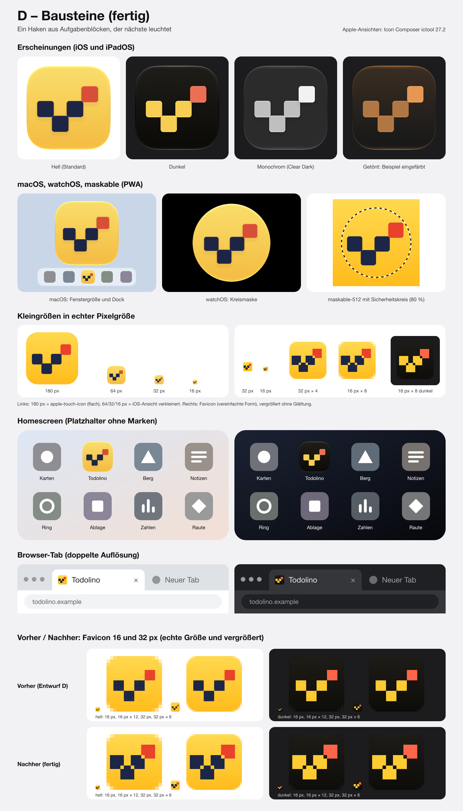

# Todolino – App-Icon „Bausteine“

Ein Haken aus vier Aufgabenblöcken, der oberste leuchtet rot, auf Gelb; dunkel gelbe Blöcke auf fast Schwarz.
Gewählt von Lino am 26.11.2026 (Karte `75EAE344`, Entwurf D). Dieser Ordner ist die **einzige Quelle** für Apple und PWA.



## Dateien

| Datei | Inhalt |
| --- | --- |
| `blocks-done.svg`, `block-next.svg` | Ebenen auf 1024 × 1024: Blöcke 200 px, Eckenradius 33, Rasterschritt 180 |
| `background.svg` | Gelber Verlauf für die PWA (Apple nimmt `fill-specializations` aus `icon.json`) |
| `favicon.svg` | Eigene Fassung im 16er-Raster: Blöcke 4 px, an den Berührpunkten 1 px Lücke; hell und dunkel |
| `Todo.icon/` | Icon-Composer-Paket; `Assets/` sind Kopien der Ebenen |
| `png/` | `ictool`-Ansichten (Belege, nicht von Hand ändern) |
| `tafel-d-final.png` | Vorschau-Tafel mit Vorher/Nachher bei 16 und 32 px |
| `entwuerfe-2026-11/` | Archiv der Entwürfe A–D |
| [`UEBERGABE-APPLE.md`](UEBERGABE-APPLE.md) | Einbau ins Apple-Repository |

| Farbe | Hell | Dunkel | Getönt |
| --- | --- | --- | --- |
| Hintergrund | `#FFD94F` → `#FFBC1C` | `#1E1C17` → `#0D0C09` | `#202020` → `#0F0F0F` |
| Drei Blöcke | `#1C2646` | `#FFCB33` | `#BDBDBD` |
| Nächster Block | `#E9412B` | `#FF6549` | `#FFFFFF` |

## Regeln für `icon.json`

- Die **erste Gruppe liegt vorn**.
- Nie `fill` neben `fill-specializations` (die Varianten würden ignoriert); der Standardwert ist der Eintrag ohne `appearance`.
- `web/tests/icons.test.ts` prüft beides.

## Ändern und neu erzeugen

```sh
SHARP_MODULE=/opt/homebrew/lib/node_modules/sharp node web/scripts/build-icons.mjs   # web/static (6 Dateien)
node design/icon/render.mjs                    # Assets kopieren, ictool-Ansichten, Tafel (ictool aus Xcode nötig)
(cd web && npx vitest run tests/icons.test.ts)
```

- Bei neuer Grafik die Nummer `?v=` in `web/static/manifest.webmanifest` und `web/src/app.html` erhöhen: Chrome (ab 144)
  behandelt Icon-URLs installierter Apps als unveränderlich
  ([Quelle](https://developer.chrome.com/blog/improvements-to-web-app-updates)).
- PWA-PNGs sind flach (ohne Apple-Material). Motivmaßstab: `icon-192/512` 1,06, `apple-touch-icon` 1,04, `maskable` 0,9
  (Radius 38 % bei 40 % Sicherheitszone). Im Apple-Kreis (watchOS) bleiben rund 16 % Abstand.
- Das Favicon ist bewusst nicht verkleinert, sondern auf das Pixelraster gezeichnet; Geometrie dort getrennt pflegen.

## Installierte PWA auf das neue Icon bringen (nach dem Deploy)

- Chrome/Edge am Desktop und Android: die App erkennt die neue URL beim nächsten Manifest-Abruf und fragt gegebenenfalls
  nach; sofort geht es durch Deinstallieren und neu Installieren.
- iPhone/iPad und Safari „Zum Dock hinzufügen“: Symbol entfernen und neu hinzufügen.
- Der Service Worker hält nichts fest: je Build neuer Cache, alte werden gelöscht; der Server sendet Icons mit `no-cache`.

## Nicht geprüft

Xcode-Import, `actool`-Build, Icon-Composer-Oberfläche, echte Geräte, Symbolwechsel an einer installierten PWA,
Tab-Darstellung echter Browserfenster, Markenrecherche.
