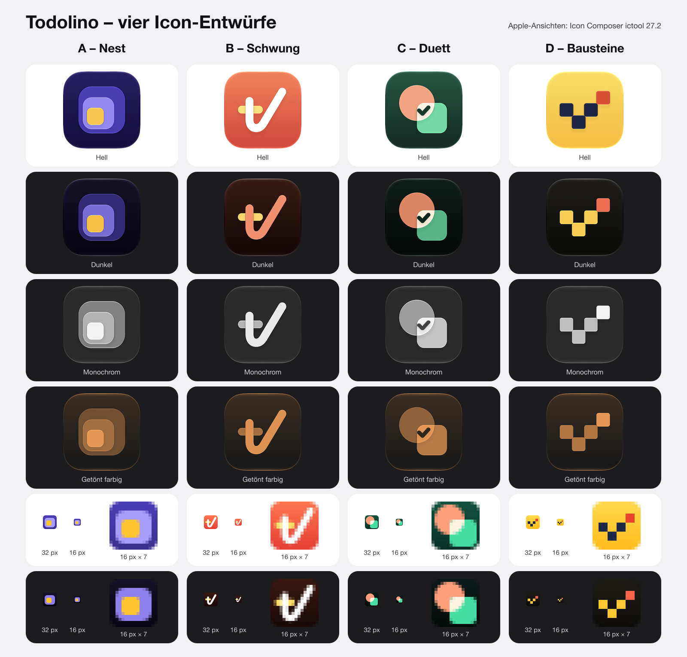

# Todolino – vier Icon-Entwürfe (November 2026)

Karte `75EAE344`. Stand 26.11.2026: **Entwürfe liegen vor, Wahl offen, nichts eingebaut.**
`design/icon/Todo.icon`, `web/static` und das Apple-Repository sind unverändert.



## Die Entwürfe

| | Idee | Farben (hell) | Ebenen |
| --- | --- | --- | --- |
| [A Nest](a-nest/tafel.png) | Projekte in Projekten, nach innen immer heller | Indigo `#271D63`, Violett `#4C3DB8` / `#9788F7`, Bernstein `#FFC531` | 3 |
| [B Schwung](b-schwung/tafel.png) | Gezeichnetes „t“ für Todolino, dessen Fuß als Haken ausschwingt | Koralle `#FF7650`–`#E43F35`, Weiß, Gelb `#FFE06B` | 2 |
| [C Duett](c-duett/tafel.png) | Mensch (Kreis) und Agent (Quadrat), die Schnittmenge ist abgehakt | Tannengrün `#12533F`, Pfirsich `#FF9F7C`, Mint `#45DDA4`, Creme | 4 |
| [D Bausteine](d-bausteine/tafel.png) | Haken aus vier Aufgabenblöcken, der nächste leuchtet | Gelb `#FFD94F`, Tinte `#1C2646`, Rot `#E9412B` | 2 |

### A – Nest
- Stärken: erklärt das Besondere (frei verschachtelte Projekte); ruhig; in Dunkel, Monochrom, Watch und
  maskable ohne Anpassung gut; 16 px bleibt klar (zwei Quadrate im Quadrat).
- Schwächen: sagt nicht „Todo“ (kein Haken); kann wie ein generisches Fenster-, Aufnahme- oder
  Bild-im-Bild-Zeichen wirken; dunkle Variante hebt sich auf dunklem Hintergrundbild wenig ab.

### B – Schwung
- Stärken: eine Linie mit starker Silhouette; Haken sofort erkennbar, eigene Form mit
  Namensbezug; sehr kontrastreich im Browser-Tab.
- Schwächen: kann auch als „t✓“ oder „tv“ gelesen werden; bei 16 px verschwindet das „t“, es bleibt ein
  Haken mit gelbem Strich; Haken auf Rot-Orange ist in dieser Kategorie nicht selten (Abstand zu
  bekannten Todo-Apps vor Veröffentlichung selbst gegenprüfen, keine Markenrecherche erfolgt).

### C – Duett
- Stärken: erzählt Zusammenarbeit von Mensch und Agent plus „erledigt“; unverwechselbare Farben;
  zwei Flächen und helle Schnittmenge bleiben auch bei 16 px und in Graustufen getrennt.
- Schwächen: vier Ebenen, mehr Detail als die anderen; der Haken entfällt im Favicon und wird ab etwa
  32 px klein; Kreis plus Quadrat allein ist eine verbreitete Formsprache; dunkler Grund auch im hellen Modus.

### D – Bausteine
- Stärken: ganz eigene, modulare Formensprache; Favicon sitzt pixelgenau im 16er-Raster; helle,
  auffällige Farbe.
- Schwächen: schwächster Entwurf als großes Symbol: wirkt locker und spielerisch (Pixelspiel, Dominosteine),
  der Haken entsteht erst im Kopf; viel freie Fläche; als verkleinertes App-Symbol bei 16/32 px dünn
  (nur das Favicon ist dort gut); rote Kachel auf Gelb hat wenig Helligkeitskontrast.

## Empfehlung

**C – Duett.** Es ist der einzige Entwurf, der das Eigene von Todolino (Mensch und Agent erledigen
gemeinsam) zeigt, sich in Farbe und Form deutlich vom bisherigen Petrol-Motiv löst und in allen
Erscheinungen funktioniert. Zweite Wahl: B, wenn Wiedererkennung im Tab und ein sofort lesbarer Haken
wichtiger sind als die Geschichte.

## Dateien je Entwurf

```
<ordner>/
  src/background.svg, src/layer-*.svg   Ebenen, 1024 × 1024, ohne Ecken, Schatten, Glanz
  <Name>.icon/                          Icon-Composer-Paket (icon.json, Assets = Kopien der Ebenen)
  favicon.svg                           vereinfachte Form, hell/dunkel per prefers-color-scheme
  png/favicon-16|32|48, icon-192|512, maskable-512, apple-touch-icon
  png/ios-default|ios-dark|ios-tinted-gray|ios-tinted-color|macos-default|watchos-default (512 px)
  tafel.png
```

`designs.mjs` ist die einzige Quelle für Formen und Farben. Änderungen dort, dann:

```sh
node design/icon/entwuerfe-2026-11/render.mjs        # erzeugt die vier Ordner neu
node --test design/icon/entwuerfe-2026-11/check.test.mjs
```

Sharp: `SHARP_MODULE`, sonst `/opt/homebrew/lib/node_modules/sharp`. Das Skript löscht und schreibt die
Entwurfsordner neu; Handänderungen aus Icon Composer vorher nach `designs.mjs` übertragen. Ein zweiter Lauf
ist nicht ganz bytegleich: `ictool` schwankt in einzelnen Pixeln (gemessen: ein Kanalwert um 1).

## Geprüft und nicht geprüft

- Apple-Ansichten stammen aus `ictool` (Icon Composer 27.2): iOS `Default`, `Dark`, `ClearDark`
  (in der Tafel „Monochrom“, Datei `ios-tinted-gray.png`), `TintedDark` mit Beispielfarbe
  (`--tint-color 0.12 --tint-strength 1`), macOS und watchOS `Default`. Ohne `ictool` zeichnet das Skript
  flache Ersatzbilder und beschriftet die Tafeln entsprechend.
- Die PWA-PNGs und Favicons sind flache Sharp/librsvg-Renderings (ohne Apple-Material).
- Watch: `ictool` setzt die 1024er Leinwand selbst in den Kreis. Alle Motive liegen im Kreis mit 80 %
  Durchmesser (Test über `maskable-512`), also innen mit Abstand. Eine eigene 1088er Fassung gibt es nicht.
- Nicht geprüft: Öffnen und Speichern in der Icon-Composer-Oberfläche, Xcode-Import und `actool`-Build,
  echte Geräte, `favicon.svg` im Dunkelmodus echter Browser, Markenrecherche.

## Formatbefunde (wichtig auch für das bisherige Icon)

Mit `ictool` 27.2 beobachtet:

1. Die **erste Gruppe in `icon.json` liegt vorn**.
2. Steht neben `fill-specializations` ein einfaches `fill`, werden die Varianten **ignoriert**. Der
   Standardwert gehört als Eintrag ohne `appearance` in die Liste.

`design/icon/Todo.icon` und das gleich aufgebaute `App/Icon/AppIcon.icon` im Apple-Repository folgen
beidem nicht: Im `ictool`-Rendering verdeckt die hintere Karte die Aufgabenkarte samt **Haken**, und die
eigenen Dunkel-Farben greifen nicht. Hier nur festgestellt, nicht geändert; ob `actool` im Build
dasselbe zeigt, ist nicht geprüft.

## Einbau nach der Wahl

**Apple (Apple-Repository)**
1. `<Name>.icon` als `App/Icon/AppIcon.icon` übernehmen (Paketname muss `AppIcon` bleiben,
   `ASSETCATALOG_COMPILER_APPICON_NAME`), altes Paket ersetzen.
2. In Icon Composer öffnen, Hell/Dunkel/Mono und die Watch-Kreismaske ansehen, speichern. Glas, Schatten
   und Glanz sind in `icon.json` als Systemeffekte aktiviert und dort feinjustierbar.
3. Alle App-Targets bauen, auf Simulator oder Gerät in den Erscheinungsarten prüfen.

**PWA**
1. Aus dem Entwurfsordner nach `web/static`: `favicon.svg`, `png/icon-192.png`, `png/icon-512.png`,
   `png/maskable-512.png`, `png/apple-touch-icon.png`.
2. `favicon.ico` aus `favicon-32.png` und `favicon-48.png` neu packen (Funktion `ico()` in
   `web/scripts/build-icons.mjs`). Das Skript leitet derzeit alles aus `design/icon/Todo.icon` ab und
   würde die neuen Dateien überschreiben: auf den gewählten Ordner umstellen oder durch eine Kopie ersetzen.
3. `manifest.webmanifest` braucht keine neuen Pfade. Service-Worker-Cache und installierte Apps prüfen
   (Symbole werden oft erst nach Neuinstallation aktualisiert).
