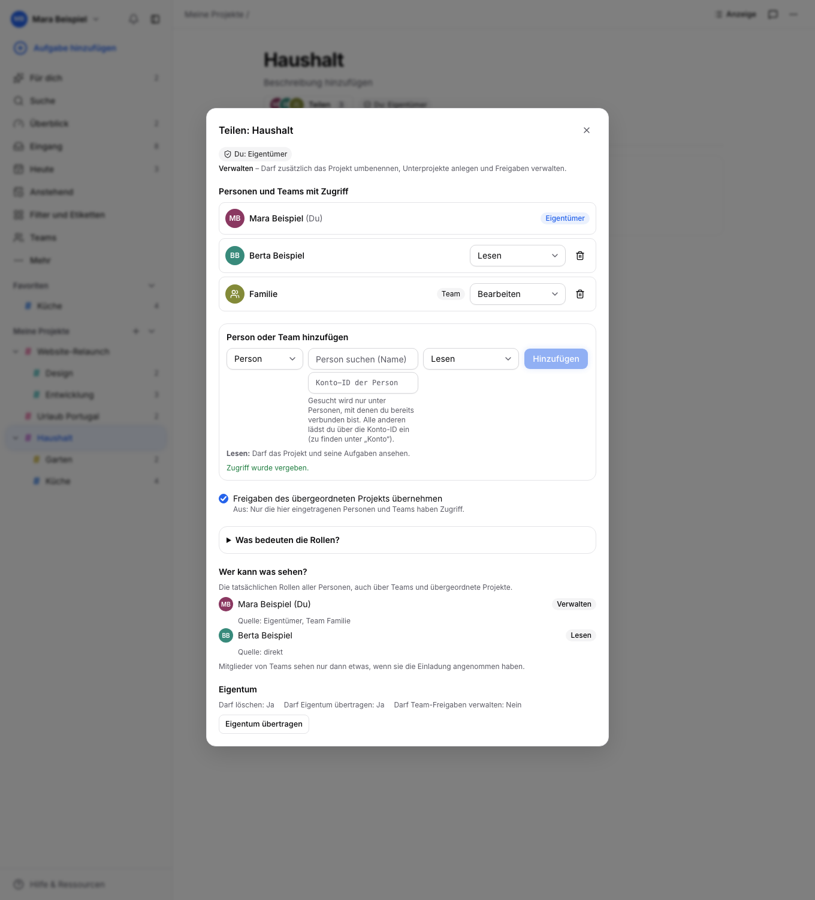
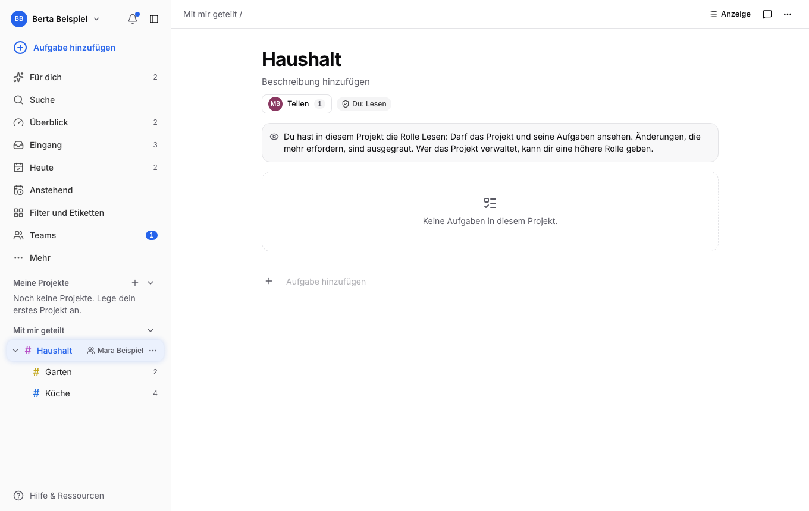
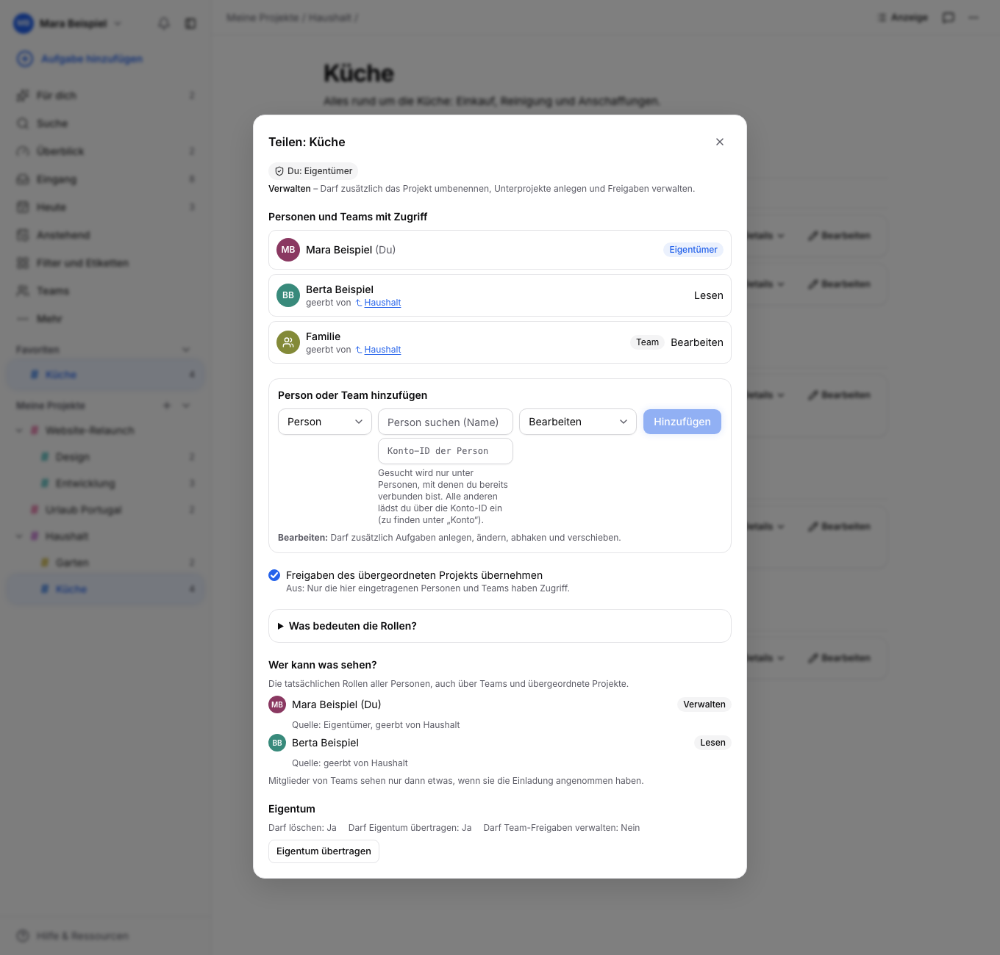
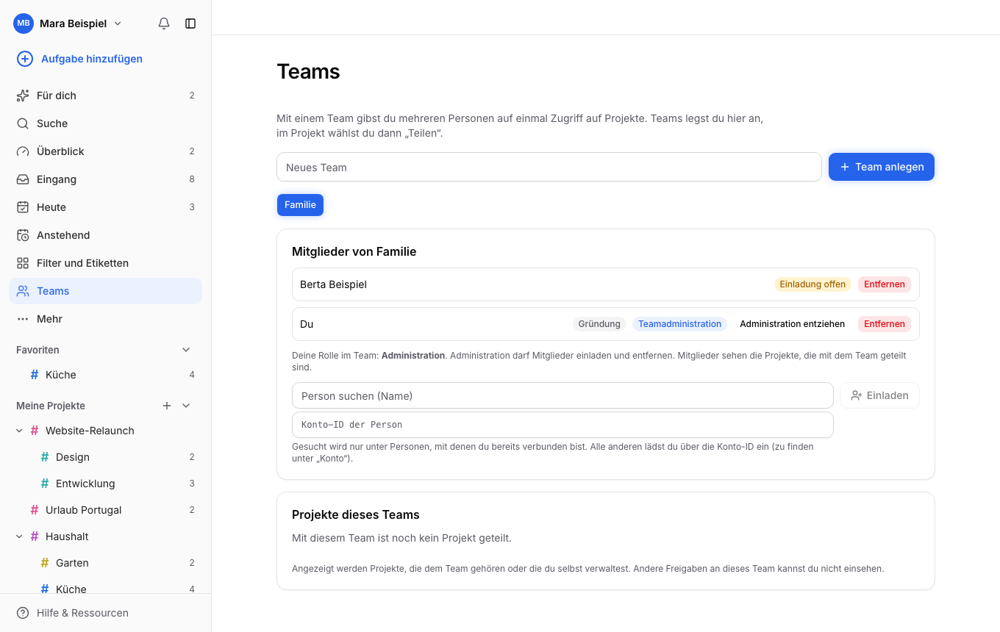
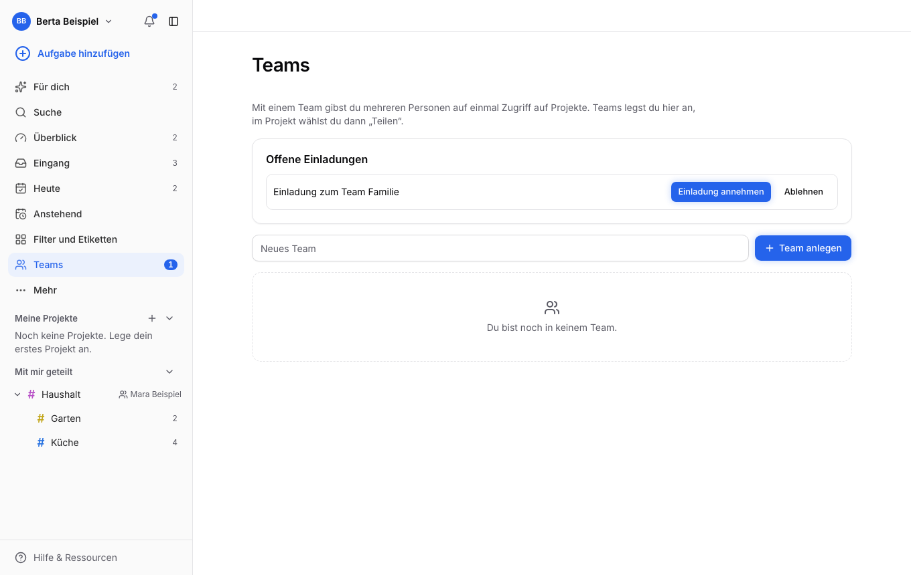
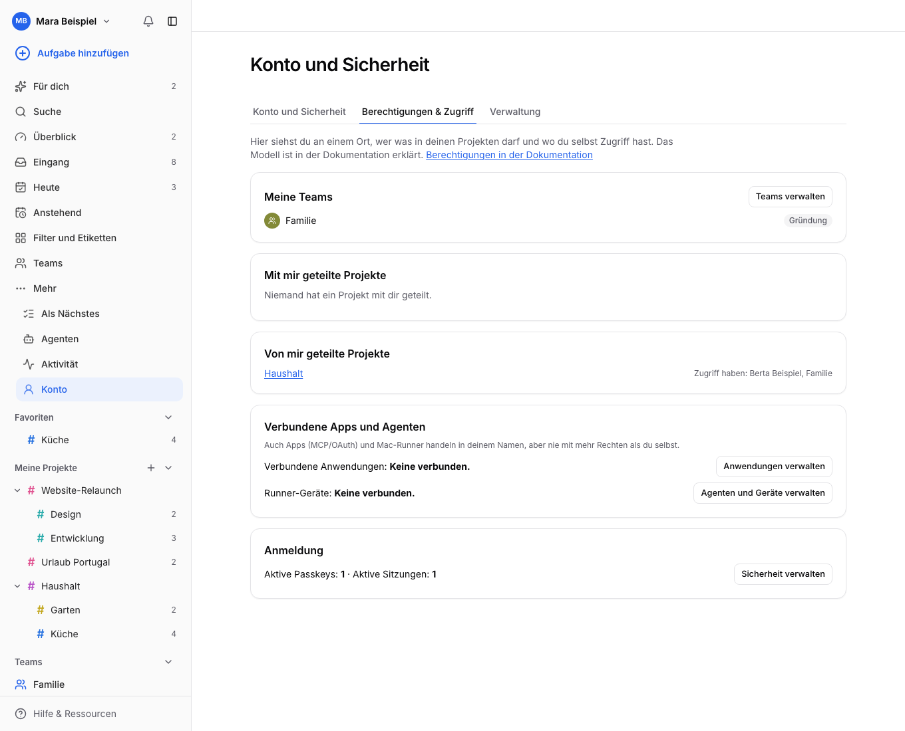

# Berechtigungen und Teilen

Stand 31.10.2026. Verständliche Erklärung des Rechtemodells von Todolino, wo es in der PWA zu finden ist und welche Lücken bewusst offen sind. Die Entscheidung dahinter steht in [ADR 0005](adr/0005-projektrechte.md), die Leitplanken in [IDENTITAET-UND-RECHTE.md](IDENTITAET-UND-RECHTE.md), der Vertrag in `contracts/sharing.yaml`.

## Kurzfassung

- Jedes Projekt hat genau **einen Eigentümer** (eine Person oder ein Team).
- Andere bekommen Zugriff über **Freigaben**: an eine Person oder an ein Team, mit einer von vier **Rollen** (Lesen, Kommentieren, Bearbeiten, Verwalten).
- **Unterprojekte erben** die Freigaben des übergeordneten Projekts. Das lässt sich pro Projekt abschalten.
- Bei mehreren Wegen zum selben Projekt (direkt, über ein Team, geerbt) gilt immer die **stärkste Rolle**. Es gibt keine Verbote und keine Herabstufung.
- Agenten und Apps (MCP/OAuth, Runner) handeln im Namen einer Person und haben **nie mehr Rechte als diese Person**.

## Wo finde ich das in der PWA?

| Wo | Was |
| --- | --- |
| **Projektkopf, Schaltfläche „Teilen“** (Avatar-Stapel und Zahl der Beteiligten), in **beiden** Modi (Klassisch und Projektmanagement) | Teilen-Fenster: Personen und Teams mit Rollen, Hinzufügen, Rolle ändern, Entfernen, Vererbung, „Wer kann was sehen?“, Eigentümerwechsel. Das Projektmenü der Seitenleiste enthält denselben Eintrag. |
| **Projektkopf, Chip „Du: Bearbeiten“** | Die eigene Rolle im Projekt. Der Tooltip erklärt, was sie erlaubt. |
| **Seitenleiste, „Teams“** (mit Zähler für offene Einladungen) | Teams anlegen, Mitglieder einladen und verwalten, Einladungen annehmen oder ablehnen, Team verlassen, Projekte des Teams. |
| **Seitenleiste, „Mit mir geteilt“** | Projekte anderer Personen, mit Symbol und Namen des Eigentümers. Eigene Projekte stehen darüber unter „Meine Projekte“. |
| **Konto, Reiter „Berechtigungen & Zugriff“** | Eine Übersicht: Meine Teams, offene Einladungen, mit mir geteilte Projekte (mit meiner Rolle), von mir geteilte Projekte (wer hat Zugriff), verbundene Apps und Runner, Anmeldung. |
| **Konto, Reiter „Verwaltung“** (nur Administration) | Recovery-Code ausstellen, Konto-ID. |

Fehlende Rechte werden **erklärt, nicht versteckt**: Wer nur lesen darf, sieht oben einen Hinweis und deaktivierte Eingabefelder, Häkchen, Statuswahl und Bearbeiten-Knöpfe. Der Tooltip sagt, was fehlt („Dafür brauchst du die Rolle Bearbeiten.“). Der Server prüft unabhängig davon jede Anfrage; die Oberfläche ist nur die freundliche Seite derselben Regel.

## Rollen

| Rolle | Darf | Kurz gesagt |
| --- | --- | --- |
| **Lesen** | Projekt, Aufgaben, Kommentare und Verlauf ansehen | Zuschauen |
| **Kommentieren** | zusätzlich Aufgaben und das Projekt kommentieren | Mitreden |
| **Bearbeiten** | zusätzlich Aufgaben anlegen, ändern, abhaken, verschieben, Planung und Kriterien pflegen | Mitarbeiten |
| **Verwalten** | zusätzlich Projekt umbenennen, verschieben, Unterprojekte anlegen, Freigaben und Vererbung ändern | Mitverantworten |

Zusätzlich gibt es **Eigentümerfähigkeiten**, die nicht aus der Rolle folgen:

- Eigentum übertragen (an eine Person oder an ein Team, dessen Administration man ist),
- das Projekt und seine Aufgaben **löschen**,
- Teamfreigaben verwalten, wenn das Projekt einem Team gehört (nur Teamadministration).

Wer das Projekt besitzt, hat immer „Verwalten“. Kommentare ändert nur die Autorin oder der Autor; löschen darf sie oder er sowie jede Person mit „Verwalten“.

## Vererbung

Ein Unterprojekt übernimmt die Freigaben seiner Eltern, bis zur Wurzel. Im Teilen-Fenster erscheinen diese Zugriffe mit dem Vermerk **„geerbt von <Elternprojekt>“**. Sie sind am Unterprojekt nicht änderbar; der Link führt zum Elternprojekt, wo man sie ändert.

Regeln (ausführlich in ADR 0005):

1. Direkte Freigaben am Projekt gelten immer.
2. Ist „Freigaben des übergeordneten Projekts übernehmen“ an, kommen die Freigaben der Eltern dazu.
3. Schaltet man das aus, enden geerbte Rechte an dieser Stelle. Direkte Freigaben und das eigene Eigentum bleiben.
4. Ein Zugang nur zu einem Unterprojekt gibt **keinen** Zugang zu den Eltern oder Geschwistern. Ist das Elternprojekt unsichtbar, wird es in der Navigation als Wurzel gezeigt.
5. Der Abschnitt **„Wer kann was sehen?“** im Teilen-Fenster rechnet alles zusammen (Eigentum, direkte Freigaben, Teams, geerbte Freigaben) und zeigt pro Person die wirksame Rolle samt Quelle.

## Teams

Ein Team ist eine Gruppe von Personen. Wer ein Projekt mit einem Team teilt, gibt allen angenommenen Mitgliedern die gewählte Rolle.

- Teams anlegen darf jede Person. Wer ein Team anlegt, ist **Gründung** und bleibt dauerhaft Administration.
- Einladungen richten sich an Konten. Sie wirken erst, wenn die eingeladene Person sie **annimmt**; sie kann sie auch ablehnen oder später das Team verlassen (die Gründung nicht).
- **Teamadministration** darf Mitglieder einladen und entfernen und Administration vergeben. Das ist unabhängig von der Projektrolle.
- Gehört ein Projekt einem Team, hat jedes angenommene Mitglied mindestens Lesen; die Administration verwaltet die Freigaben.
- Personen finden: Die Suche liefert nur Personen, mit denen schon eine Beziehung besteht (Team, Projekt). Alle anderen lädt man **über die Konto-ID** ein (zu finden im Profil der Person).

## Berechtigungen im Konto

Die Übersicht zeigt nur, was das Backend sicher liefert:

- **Meine Teams** und **offene Einladungen** (annehmen oder ablehnen),
- **Mit mir geteilt**: Projekt, Eigentümer, meine Rolle,
- **Von mir geteilt**: Projekte, die ich besitze und an andere freigegeben habe, mit den Personen und Teams,
- **Verbundene Apps und Agenten**: Zahl der aktiven OAuth-Verbindungen und Runner-Geräte mit Sprung zur Verwaltung,
- **Anmeldung**: aktive Passkeys und Sitzungen mit Sprung zur Verwaltung.

Freigaben sind serverseitig nur mit der Rolle „Verwalten“ lesbar. Deshalb sind „Von mir geteilt“ und die Projektliste eines Teams auf Projekte beschränkt, die ich verwalte oder besitze.

## Agenten, MCP und Runner

Menschlicher Login, MCP/OAuth und Runner sind getrennte Rollen. Der wirksame Zugriff eines Agenten ist die **Schnittmenge** aus

1. den aktuellen Rechten der Person, in deren Namen er handelt,
2. den bei der Zustimmung gewählten **Scopes** (lesen, schreiben, kommentieren),
3. den bei der Zustimmung ausdrücklich **zugelassenen Projekten**,
4. bei lokalen Läufen der Runner-Bindung und der Freigabe am Mac.

Verliert die Person Rechte, verliert der Agent sie sofort; er kann seine Rechte nie selbst erweitern. „Aufgabe bearbeiten“ erlaubt nicht, Code auszuführen; das Starten von Agentenläufen ist eine eigene Fähigkeit und derzeit dem Eigentümer des Projekts vorbehalten. Verbindungen und Geräte sind einzeln widerrufbar (Konto, „Verbundene Anwendungen“, und Seite „Agenten“).

## Klassisch und Projektmanagement

Der Modus eines Projekts („Anzeige“) ändert nur die **Darstellung**: Klassisch zeigt reine Aufgabenliste und Board, Projektmanagement zusätzlich Überblick, Meilensteine, Agenten und Sync. Er ändert **keine Rechte**. Die Schaltfläche „Teilen“, die eigene Rolle und die Erklärung fehlender Rechte stehen in beiden Modi.

## Warum fiel das System bisher nicht auf?

Befund vom 31.10.2026, bevor die Oberfläche überarbeitet wurde:

- Das Backend kannte Teams, Rollen, Vererbung und die Sichtbarkeitsprüfung bereits (ADR 0005), die PWA hatte `SharingPanel`, `TeamsView` und `PersonPicker`.
- Der Einstieg war aber ein unscheinbarer, schmaler Textknopf „Teilen“ in der Kopfleiste (auf dem Handy nur ein Symbol) und ein Eintrag im Dreipunkt-Menü eines Projekts. „Teams“ lag versteckt unter „Mehr“ in der Seitenleiste.
- Fremde Projekte sahen aus wie eigene: kein Hinweis, wem sie gehören und welche Rolle man hat. Fehlende Rechte führten zu Fehlermeldungen oder fehlenden Wirkungen statt zu einer Erklärung.
- Im Konto stand nur die Konto-ID mit einem Satz zur Einladung; eine Übersicht „Wer darf was“ gab es nicht.
- Das Fenster selbst zeigte Roh-IDs statt Namen, keine Erklärung der Rollen und keine Vererbung.

## Verwaltung (Administration)

Vorhanden und im Reiter „Verwaltung“ gebündelt: Recovery-Code für ein Konto ausstellen und die eigene Konto-ID. Der Reiter ist für Nicht-Administratoren sichtbar, erklärt dort aber nur, dass der Bereich Administratoren vorbehalten ist.

## Lücken und Vorschläge

Nichts hiervon ist umgesetzt; es sind Vorschläge zur Entscheidung.

**Backend fehlt (bewusst nicht gebaut):**

| Lücke | Vorschlag |
| --- | --- |
| Nutzerliste für die Administration | `GET /v1/admin/users` (Name, Anlage, letzter Login, Status), nur für Administration, paginiert |
| Konten sperren und entsperren | `POST /v1/admin/users/{id}/disable` und `/enable`; gesperrte Konten verlieren Sitzungen, OAuth-Grants und Runner |
| Konten löschen | Löschen mit Übertragung oder Löschen der Projekte (Eigentümerfrage, FK-Kaskade aus ADR 0005 beachten) |
| Datenexport | Export aller eigenen Projekte, Aufgaben, Kommentare und Anhänge als Archiv, zugleich DSGVO-Auskunft |
| Freigaben eines Teams einsehen | `GET /v1/teams/{id}/projects` (nur Projekte, die der anfragenden Person sichtbar sind); heute sieht man nur, was man selbst verwaltet |
| Alle Zugriffe von mir aus einer Hand | `GET /v1/me/access` mit „mit mir geteilt“, „von mir geteilt“ und Rollen in einer Antwort, statt je Projekt Grants zu lesen |
| Aufgaben löschen nur für Eigentümer | Löschrecht für „Bearbeiten“ prüfen (Papierkorb statt hartem Löschen als Alternative) |
| Einladung unregistrierter Personen in ein Team | Einladungslink mit Rolle, der Registrierung und Annahme verbindet |
| Verlauf der Rechteänderungen | Audit-Ereignisse „Freigabe erteilt/entzogen, Eigentum übertragen“ im Aktivitätsfeed |
| Ablaufdatum für Freigaben | optionales `expiresAt` je Freigabe (Gäste, Projekte auf Zeit) |

**Roadmap-Ideen für das Rechtemodell:**

- **Zuweisungen an Personen**: „Wer macht das?“ je Aufgabe, mit Filter „Mir zugewiesen“ und Benachrichtigung. Setzt voraus, dass die zugewiesene Person das Projekt sehen darf; Zuweisung ist keine Freigabe.
- **Feinere Rollen**: etwa „Gast“ (nur eigene und zugewiesene Aufgaben), „Kommentieren und Status ändern“ (Abhaken ohne Bearbeiten), „Nur Aufgaben anlegen“. Rollen weiter als Rang statt freier Rechtematrix halten, damit die Erklärung einfach bleibt.
- **Nutzerverwaltung** mit Rollen auf Instanzebene (Administration, Mitglied, Gast) statt des einzelnen Admin-Flags.
- **Agentenstart als Freigabe**: `canStartAgent` für Teamprojekte und eigene Rolle „Agenten starten“, statt Eigentümer-only.
- **Teams mit Untergruppen** und Rollen im Team (Mitglied, Betrachter).
- **Freigabelinks** (nur Lesen, mit Ablauf) für Außenstehende.

## Screenshots

Alle Aufnahmen erzeugt `web/screenshots/capture.mjs` mit erfundenen Demo-Daten gegen ein frisches Backend, Desktop, Dunkel und Mobil, siehe Seite „Screenshots“ der Dokumentation.
